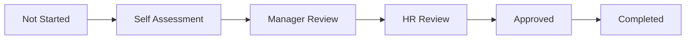
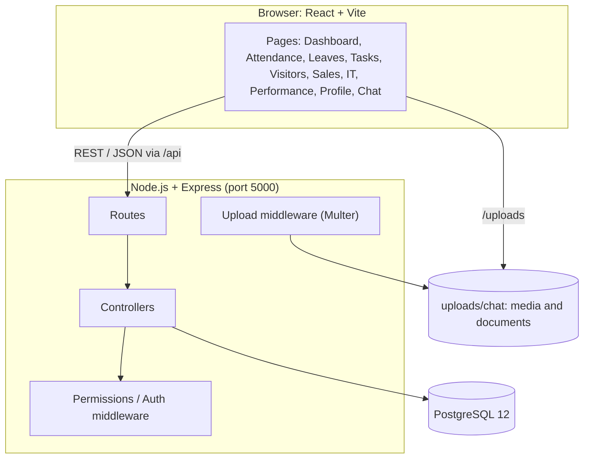

<div align="center">

# Sparsh HRMS

**A full-stack Human Resource Management platform with a built-in, WhatsApp-style team chat.**

Employees · Attendance · Leaves · Tasks · Visitors · Sales Queries · IT Helpdesk · Performance Reviews · Notifications · Team Chat


</div>

---

## Table of Contents

1. [Overview](#overview)
2. [Tech Stack](#tech-stack)
3. [Modules](#modules)
4. [Team Chat](#team-chat)
5. [System Architecture](#system-architecture)
6. [Project Structure](#project-structure)
7. [Database](#database)
8. [Getting Started](#getting-started)
9. [Roles and Access](#roles-and-access)
10. [Project Status and Roadmap](#project-status-and-roadmap)
11. [Development Notes](#development-notes)
12. [License](#license)

---

## Overview

Sparsh HRMS brings everyday company workflows into one web application. Employees use it to mark attendance, apply for leave, work on assigned tasks, raise IT tickets and talk to colleagues. Admins and HR use it to approve leave, assign and review tasks, handle sales queries, run performance reviews and manage group conversations.

The application is a **React single-page app** talking to a **Node.js / Express REST API**, backed by a **PostgreSQL** database.

---

## Tech Stack

| Layer | Technology |
|---|---|
| **Frontend** | React 19, Vite 8, Tailwind CSS 4, React Router 7 |
| **UI libraries** | Lucide React (icons), React Hot Toast (notifications), `@emoji-mart/data` (emoji catalogue), `pdfjs-dist` (PDF support) |
| **Backend** | Node.js, Express 5, `pg` (PostgreSQL driver), `cors`, `dotenv`, Multer 2 (file uploads), Nodemon (dev reload) |
| **Database** | PostgreSQL 12 |
| **Tooling** | ESLint 10, Git |
| **Development OS** | Ubuntu 20.04 LTS |

---

## Modules

| Module | What it does | Data source |
|---|---|---|
| **Login / Session** | Sign in with employee code or email and password; protected routes; role-aware screens | PostgreSQL |
| **Dashboard** | Attendance widget, attendance calendar, leave requests, assets and announcements panels | PostgreSQL (announcements use sample data) |
| **Employee Directory** | Searchable phone directory of all employees | PostgreSQL |
| **Attendance** | Check-in and check-out with location capture and reverse geocoding, monthly attendance history | PostgreSQL |
| **Leaves** | Apply for leave, track status and balance, admin approval queue | PostgreSQL |
| **Tasks** | Create and assign tasks, update status, submit reports, admin review of submissions | PostgreSQL |
| **Visitors** | Register and track visitors | PostgreSQL |
| **Sales Query** | Record sales queries and assign them to employees, with assignment notifications | PostgreSQL |
| **Visit Map** | Route and visit map view | Prototype, sample data |
| **IT Helpdesk** | Raise tickets, assign them, post updates and track status | PostgreSQL |
| **Performance Review** | Review cycles, goals, self assessment, manager and HR review, approval and history | PostgreSQL |
| **Notifications** | In-app notification panel with read and unread state | PostgreSQL |
| **Profile** | Personal details, salary slip, documents, holidays, assets, QR code, change password | Front-end views, some sample data |
| **Team Chat** | Direct and group messaging with media, polls and group roles | PostgreSQL, see [Team Chat](#team-chat) |

### Performance review workflow



The current review cycle is structured around **FY 2026–27**.

---

## Team Chat

An internal messaging system modelled on WhatsApp Web and integrated with the HRMS employee records.

### Messaging

- Direct (one-to-one) and group conversations
- Reply, edit (within 5 minutes of sending), forward, pin and star
- **Delete for everyone** (sender only) and **Delete for me** (any participant)
- Reactions with a full searchable emoji picker and recent emojis, plus a reaction details card
- Message formatting: bold, italic, strikethrough, inline code, code blocks, lists and quotes
- Clickable links, in-chat search with highlighting, message selection mode
- Delivery states: sent, delivered, read
- Clear chat and delete chat (per participant)
- Report message

### Media and documents

- Send photos, videos and documents with captions
- Preview before sending, with **crop**, **doodle**, undo and redo, copy and download
- Add more files from the thumbnail strip, with a discard confirmation
- WhatsApp-style 2×2 media grid for four or more files
- Full-screen media viewer with zoom, rotate, flip, thumbnails and video playback
- PDF preview, and "Save as" / download for received files
- **Chat Info panel** with Media, Documents and Links tabs
- **Multi-select** in the Info panel: download, forward and delete across Media, Documents and Links
- Forwarding keeps attachments

### Polls

- Create polls with several options, single or multiple answers, and optional vote changes
- Vote and view who voted for what

### Groups, roles and permissions

- **Only system admins can create groups.** The creator becomes the group **Owner**.
- Group photo, name and description can be edited by Owner, Super Admin and Admin.
- A group can be set to **"Only admins can send messages"**.

| Action | Owner | Super Admin | Admin | Member |
|---|:---:|:---:|:---:|:---:|
| Role chip shown | Owner | Super Admin | Admin | none |
| Add people | ✅ | ✅ | ✅ | ❌ |
| Remove a member | ✅ | ✅ | ✅ | ❌ |
| Remove an Admin | ✅ | ✅ | ❌ | ❌ |
| Remove a Super Admin | ✅ | ❌ | ❌ | ❌ |
| Promote a member to Admin | ✅ | ✅ | ✅ | ❌ |
| Demote an Admin | ✅ | ✅ | ❌ | ❌ |
| Make or remove a Super Admin | ✅ | ❌ | ❌ | ❌ |
| Edit name, description, photo | ✅ | ✅ | ✅ | ❌ |
| Create polls in a group | ✅ | ✅ | ✅ | ❌ |
| Toggle "only admins can send messages" | ✅ | ✅ | ✅ | ❌ |
| Send messages, files, react, vote | ✅ | ✅ | ✅ | ✅ (unless admins-only) |

Direct chats have no restrictions: both people can send anything, including polls. The Owner can never be removed. All of these rules are enforced on the backend, not only hidden in the interface.

---

## System Architecture



- In development, Vite serves the frontend on **5173** and proxies `/api` and `/uploads` to the backend on **5000** (see `frontend/vite.config.js`).
- Controllers hold the business rules and use SQL through a pooled `pg` connection.
- Chat permission rules live in one place: `backend/src/controllers/chat.permissions.js`.
- Chat media is stored on disk under `backend/uploads/chat`, with metadata in PostgreSQL.

---

## Project Structure

```text
sparsh-hrms/
├── backend/
│   ├── .env.example                 # copy to .env
│   ├── package.json
│   └── src/
│       ├── server.js                # Express app, route mounting, startup
│       ├── config/db.js             # PostgreSQL connection pool
│       ├── routes/                  # one file per module
│       │   ├── employee.routes.js
│       │   ├── attendanceRoutes.js
│       │   ├── leavesRoutes.js
│       │   ├── tasksRoutes.js
│       │   ├── visitorsRoutes.js
│       │   ├── salesQueriesRoutes.js
│       │   ├── itRoutes.js
│       │   ├── performanceReview.routes.js
│       │   └── chat.routes.js
│       ├── controllers/             # business logic
│       │   ├── chat.controller.js        # conversations, messages, reactions, attachments
│       │   ├── chat.group.controller.js  # group roles, members, group info and photo
│       │   ├── chat.permissions.js       # who may do what in chat
│       │   ├── polls.controller.js       # create poll, vote
│       │   ├── chat.polls.helper.js      # attach poll data to messages
│       │   └── …one controller per other module
│       ├── middleware/
│       │   ├── chatAuth.js
│       │   ├── chatUpload.js        # file types, size limits, storage
│       │   └── errorHandler.js
│       ├── realtime/chat.realtime.js
│       └── db/schema.sql            # database schema
│
├── frontend/
│   ├── index.html
│   ├── vite.config.js               # dev server and API proxy
│   ├── public/                      # favicon, HR documents
│   └── src/
│       ├── main.jsx · App.jsx       # entry point and routes
│       ├── context/AuthContext.jsx  # logged-in employee
│       ├── pages/                   # one page per module, plus settings/ChatSettings.jsx
│       ├── components/
│       │   ├── layout/              # Sidebar, Topbar, DashboardLayout, ProfileDropdown
│       │   ├── chat/
│       │   │   ├── info/            # ChatInfoPanel: members, media, documents, links
│       │   │   ├── media/           # composer, lightbox, editor, attachment rendering
│       │   │   └── poll/            # poll composer, poll message, votes panel
│       │   ├── attendance · dashboard · it · leaves · profile
│       │   ├── sales · tasks · topbar · visitors · visitmap · ui · routes
│       ├── data/                    # sample data for prototype screens
│       └── utils/messageLinks.js
└── README.md
```

---

## Database

PostgreSQL, database name **`sparsh_hrms`**. The schema is in `backend/src/db/schema.sql` and contains table definitions, constraints, indexes and triggers only (no employee data and no credentials).

| Area | Tables |
|---|---|
| Employees and HR | `employees`, `attendance`, `leaves` |
| Tasks | `tasks`, `task_assignments` |
| Visitors and sales | `visitors`, `sales_queries`, `sales_query_notifications` |
| IT helpdesk | `it_tickets`, `it_ticket_updates` |
| Performance | `performance_cycles`, `performance_reviews`, `performance_goals`, `performance_review_history` |
| Notifications | `notifications` |
| Chat | `chat_conversations`, `chat_participants`, `chat_messages`, `chat_message_reactions`, `chat_message_attachments`, `chat_message_receipts`, `chat_pinned_messages`, `chat_starred_messages`, `chat_message_reports`, `chat_hidden_messages` |
| Chat polls | `chat_polls`, `chat_poll_options`, `chat_poll_votes` |

Chat-specific notes:

- Group roles are `owner`, `super_admin`, `admin` and `member` (`chat_participants.participant_role`).
- "Delete for me" is stored per person in `chat_hidden_messages`; "Delete for everyone" marks the message itself as deleted.
- `chat_conversations.only_admins_can_message` holds the admins-only setting.

---

## Getting Started

### Prerequisites

- **Node.js 20.19+ or 22.12+** (required by Vite 8)
- **PostgreSQL 12+**
- Git

### 1. Clone

```bash
git clone <repository-url>
cd sparsh-hrms
```

### 2. Create the database

```bash
sudo -u postgres createdb sparsh_hrms
sudo -u postgres psql -d sparsh_hrms -f backend/src/db/schema.sql
```

### 3. Configure the backend

```bash
cd backend
cp .env.example .env
```

Edit `.env`:

```env
PORT=5000
DB_USER=postgres
DB_PASSWORD=your_password_here
DB_HOST=localhost
DB_PORT=5432
DB_NAME=sparsh_hrms
```

### 4. Run the backend

```bash
npm install
npm run dev        # http://localhost:5000
```

> Start the backend **from the `backend/` folder**. Uploaded chat files are saved to `backend/uploads/chat`, which is created automatically.

### 5. Run the frontend

```bash
cd ../frontend
npm install
npm run dev        # http://localhost:5173
```

### 6. Sign in

Open `http://localhost:5173` and sign in with an employee code or email and password from your `employees` table. Employees whose `role` is `admin` get the admin screens and can create chat groups.

### Useful commands

| Command | Where | Purpose |
|---|---|---|
| `npm run dev` | `backend/` | Start the API with automatic reload |
| `npm run dev` | `frontend/` | Start the Vite dev server |
| `npm run build` | `frontend/` | Production build into `frontend/dist` |
| `npm run lint` | `frontend/` | Run ESLint |

---

## Roles and Access

There are two layers of roles, and they are separate:

| Layer | Where it is stored | Values | Used for |
|---|---|---|---|
| **System role** | `employees.role` | `admin`, `employee` | Admin screens (leave approval, task review, performance, etc.) and who may **create chat groups** |
| **Group role** | `chat_participants.participant_role` | `owner`, `super_admin`, `admin`, `member` | Powers inside one chat group (see the table in [Team Chat](#team-chat)) |

A system admin who is added to someone else's group joins as a plain member until the group's leaders promote them.

---

## Project Status and Roadmap

### ✅ Completed

- [x] Employees, attendance, leaves, tasks, visitors, sales queries, IT helpdesk
- [x] Performance review workflow
- [x] Notifications
- [x] Profile area and employee directory
- [x] Team chat: direct and group messaging, reactions, replies, edit, delete for me and for everyone, pin, star, forward
- [x] Media composer (crop, doodle), media viewer, 2×2 media grid, documents and PDF preview
- [x] Chat Info panel with media, documents and links, and multi-select download, forward and delete
- [x] Polls
- [x] Group roles (Owner, Super Admin, Admin), admin-only group creation, admin-only messaging, group photo and info editing

### 🚧 Pending

- [ ] **WebSockets**: live delivery of messages, reactions, edits, deletes, read receipts, typing indicators and notifications
- [ ] **Dark theme**: the theme toggle is in the top bar; the dark colour scheme is not implemented yet
- [ ] **Chat settings**: the settings page exists (read receipts, notifications, sound alerts, online status); the options are not yet connected to chat behaviour
- [ ] A few remaining UI polish fixes

### 🔭 Planned: production hardening

- [ ] Password hashing and token-based authentication
- [ ] Verified identity on every API and WebSocket request
- [ ] Input validation and authorization audit across all modules
- [ ] Automated tests
- [ ] Logging and monitoring
- [ ] Production deployment configuration and backup procedure

---

## Development Notes

- The project began on Windows and now lives on **Ubuntu 20.04 LTS**. All current development, testing and builds are done on Ubuntu.
- Source files carry a header comment and consistent formatting; behaviour was not changed by the formatting clean-up.
- Prototype screens (Visit Map, Announcements, Holidays) use sample data from `frontend/src/data/`.
- Employee HR documents under `frontend/public/documents/` and the local seed script `backend/src/db/seed.js` are intentionally not committed to Git.

---

## License

This is a private, internal application. Licence and distribution terms should be defined before any public release.